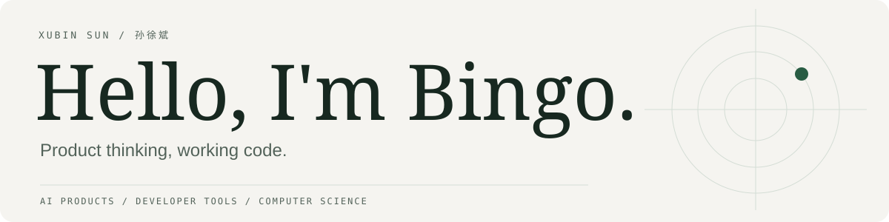

<picture>
  <source media="(prefers-color-scheme: dark)" srcset="assets/header-dark.svg">
  <source media="(prefers-color-scheme: light)" srcset="assets/header-light.svg">
  
</picture>

  <a href="https://bingosun.vercel.app/">Personal website · 个人网站</a>
  &nbsp; / &nbsp;
  <a href="#selected-work">Selected work</a>
  &nbsp; / &nbsp;
  <a href="https://github.com/123bingowinnn?tab=repositories&amp;type=public">Public repositories</a>

I'm **Xubin (Bingo) Sun / 孙徐斌**, a Computer Science master's student at Yale. I’m interested in AI products and the small interaction choices that make them useful. I like taking an idea far enough that someone can try it.

Some of that work happens at hackathons with friends. Some starts with something I wish I had on my own computer.

## Selected work

### Touch Drama · 触手可剧

A first-person interactive short-drama prototype where viewers act inside the scene: tapping, holding, or dragging to move the story forward. Our team also turned the AI script, storyboard, and video workflow into reusable production Skills.

The project received **National Third Prize and RMB 30,000 in team prize money** at the Douyin AI Innovators Program Hackathon.

[Project story and demo](https://bingosun.vercel.app/projects/chushou-keju)

### Guicheng · 归程

A four-person hackathon project about life, loss, and the practical work around saying goodbye. We built a prototype that helps relatives organize next steps, required documents, and progress, with city-specific information and sources they can check.

[Explore the team’s code](https://github.com/123bingowinnn/death-education-hackathon)

### Another Me · 你的情绪分身

A team prototype built for the Wenzhou hackathon. An emotion becomes an egg, then a digital companion, with a shared space for people who feel something similar. We explored the flow across a mobile web experience, from discovering a mood to hatching and sharing a companion.

[Hackathon project](https://github.com/123bingowinnn/Hackthon) · [Pixel-cat experiment](https://github.com/123bingowinnn/another-me)

### UnNote

A macOS app for capturing tasks without leaving what you’re doing. Type a thought, speak, or take a screenshot; the app turns it into a structured todo. I designed and built the capture workflow, native interface, and AI command routing, with local storage and reversible actions.

[Explore the code](https://github.com/123bingowinnn/UnNote)

### What’s in My Fridge · 冰箱里面有什么

A web app for keeping track of ingredients and expiry dates. I built it around a simple question: what do I already have, and what should I use next? Personal food inventory and expiry tracking help make everyday kitchen decisions easier.

[Try the app](https://fridge-clear.vercel.app/)

### Vibe Paper

A local workspace for writing LaTeX papers alongside experiment code. Coding agents can work with the actual files and results, while a local compile and PDF preview loop keeps the paper close to the experiment.

[Explore the code](https://github.com/123bingowinnn/vibe_paper)

## Hackathons & recognition

- **Douyin AI Innovators Program Hackathon** — National Third Prize; RMB 30,000 team prize · Touch Drama.
- **2025 Cougar Investigator Grant Challenge** — finalist · [Real-time digital human for dementia care](https://bingosun.vercel.app/projects/digital-human-dementia).
- **Wenzhou-Kean University** — Dean’s Scholarship, second prize in 2024–2025 and third prize in 2022–2023; undergraduate GPA 3.922/4.0, top 5%.

## Research & other builds

I’ve coauthored research on [LLM negative rejection](https://doi.org/10.1007/s44443-025-00334-6), [robust medical image classification](https://doi.org/10.1117/12.3044867), and [medical image dataset distillation](https://doi.org/10.1117/12.3045706).

Other public projects include [PacketScope](https://github.com/123bingowinnn/packetscope), a reproducible network measurement toolkit, and my [campus e-bike detection capstone](https://github.com/123bingowinnn/campus-ebike-multi-violation-detection).

[Personal website](https://bingosun.vercel.app/) · [Public project directory](PROJECTS.md)

中文介绍

### 你好，我是孙徐斌，也可以叫我 Bingo。

目前在耶鲁大学读计算机科学硕士，关注 AI 产品和人机交互。我喜欢把想法做成能试用的东西：有些来自与朋友一起参加的黑客松，有些来自自己日常工作中的小麻烦。

### 一些作品

**触手可剧**：团队共同完成的第一人称互动短剧原型，让用户通过点击、长按、拖动等动作推动剧情。创作侧将剧本、分镜和视频生成流程整理成可复用的 Skills。项目获抖音 AI 创变者计划黑客松全国三等奖，团队奖金 3 万元。[项目介绍与演示](https://bingosun.vercel.app/projects/chushou-keju)

**归程**：四人团队的黑客松项目，围绕生命与告别事务，帮助家属整理办理步骤、所需材料和进度，并提供可核对的城市资料来源。[团队代码](https://github.com/123bingowinnn/death-education-hackathon)

**Another Me**：温州黑客松团队原型，从情绪内容出发，经过孵化、数字陪伴和树洞共鸣，探索人与情绪分身的互动。[项目代码](https://github.com/123bingowinnn/Hackthon)

**UnNote**：我设计并开发的 macOS AI 待办工具，通过文字、语音或截图捕获任务，串联原生界面、AI 指令路由与本地存储。[代码](https://github.com/123bingowinnn/UnNote)

**冰箱里面有什么**：我设计并开发的食材库存与保质期管理 Web 应用，帮助用户看清冰箱里已有的食材、记录到期时间，减少重复购买和遗忘。[在线体验](https://fridge-clear.vercel.app/)

**Vibe Paper**：把论文写作放进实验项目里的本地 LaTeX 工作区，让 coding agent 结合代码和结果写作，并通过本地编译预览 PDF。[代码](https://github.com/123bingowinnn/vibe_paper)

### 比赛与成果

- 触手可剧：抖音 AI 创变者计划黑客松全国三等奖，团队奖金 3 万元。
- 面向认知症照护的实时数字人：入围 2025 Cougar Investigator Grant Challenge 决赛。
- 温州肯恩大学院长奖学金：2024–2025 学年二等奖、2022–2023 学年三等奖；本科 GPA 3.922/4.0，专业前 5%。
- 共同撰写了大语言模型负向拒识、医学图像分类鲁棒性和医学图像数据集蒸馏相关论文，论文链接见上方 Research 部分。

[更多经历和项目](https://bingosun.vercel.app/)

